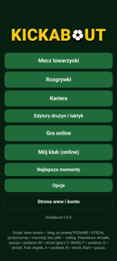
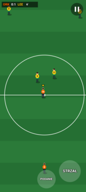
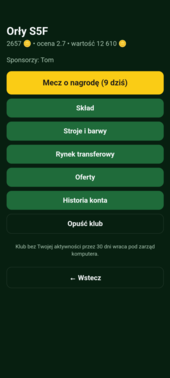
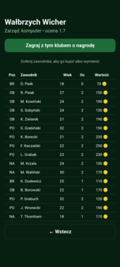
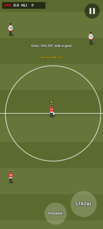
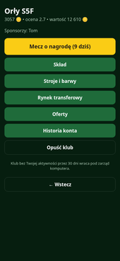
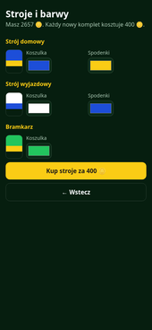
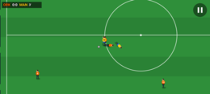
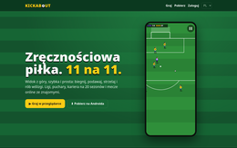
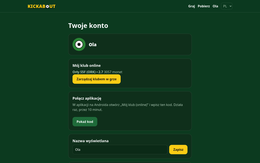

# Kickabout

Zręcznościowa piłka nożna z widokiem z góry, 11 na 11, na Androida (APK) i przeglądarkę, ze stroną www, kontami graczy, klubami online i grą online.

## Zrzuty ekranu

<p>
<a href="docs/screenshots/android-1-menu.png"></a>
<a href="docs/screenshots/android-2-match.png"></a>
<a href="docs/screenshots/android-3-club.png"></a>
<a href="docs/screenshots/android-4-market.png"></a>
<a href="docs/screenshots/android-5-club-match.png"></a>
<a href="docs/screenshots/www-3-game-club.png"></a>
<a href="docs/screenshots/www-4-game-kits.png"></a>
</p>
<p>
<a href="docs/screenshots/android-6-landscape.png"></a>
<a href="docs/screenshots/www-1-home.png"></a>
<a href="docs/screenshots/www-2-account.png"></a>
</p>

## Co jest w grze

- **Mecz:**
  - 11 na 11 z umiejętnościami zawodników (podania, strzały, główki, odbiór, kontrola, szybkość, bramkarz);
  - 9 formacji i własne taktyki;
  - 3 zmiany, faule, kartki, rzuty wolne i karne;
  - 7 rodzajów murawy (losowa albo zależna od pory roku);
  - zmiana stron, dogrywka, seria rzutów karnych;
  - numery na koszulkach, pauza, powtórki goli, statystyki, dźwięk.
- **Sterowanie:** dotyk (drążek po lewej, po prawej przyciski PODANIE i STRZAŁ; im dłużej trzymasz STRZAŁ, tym mocniej; bez piłki oba robią wślizg), klawiatura (spacja = podanie, M = strzał; gracz 2: WASD, F, G) i pad (A = podanie, B = strzał). Gra działa w pionie i w poziomie.
- **Długość meczu:** 5, 10, 15 albo 20 minut.
- **Tryby:**
  - mecz towarzyski (gracz kontra komputer, 2 graczy na jednym urządzeniu, komputer kontra komputer);
  - rozgrywki: liga, puchar (jeden mecz albo dwumecz z bramkami na wyjeździe), turniej (grupy + puchar), gotowe albo własne;
  - kariera (20 sezonów);
  - gra online;
  - klub online (konto na stronie).
- **Klub online** (wymaga konta, zob. [Klub online i monety](#klub-online-i-monety)): własna drużyna z losowymi, słabymi zawodnikami, monety, rynek transferowy, wymiany, kupno klubu, sponsoring, stroje, nagrody za mecze.
- **Kariera:** grający trener albo trener, dwie ligi z awansem i spadkiem, puchar, finanse, rynek transferowy, oferty pracy, starzenie się zawodników.
- **Edytory:** drużyny (nazwy, stroje, zawodnicy, umiejętności) i taktyki (przeciąganie zawodników).
- **Najlepsze momenty:** gole zapisują się automatycznie, można je odtwarzać, eksportować i importować.

- **Drużyny:**
  - 8 lig europejskich (Anglia, Hiszpania, Niemcy, Włochy, Francja, Holandia, Portugalia, Polska) po 4 klasy rozgrywkowe (I–IV liga) z 12 klubami, łącznie 384 kluby;
  - nazwy klubów w formacie „prawdziwe miasto + wymyślona nazwa” (np. „London Navigators”, „Kraków Burza”);
  - 40 reprezentacji (24 z Europy, 16 z reszty świata);
  - wszyscy zawodnicy są fikcyjni: inicjał i nazwisko z list popularnych imion i nazwisk danego kraju (`src/names.ts`, 28 pul), bez nazwisk znanych piłkarzy.
- **Gotowe rozgrywki:**
  - w każdym kraju I–IV liga i puchar kraju (48 klubów);
  - dla klubów Puchar Kontynentu (grupy, potem dwumecze) i Tarcza Kontynentu;
  - dla reprezentacji Turniej Narodów Europy (16 drużyn) i Turniej Narodów Świata (32 drużyny);
  - nazwy rozgrywek są opisowe, nie są to marki UEFA ani FIFA.
- **Kariera:** w dowolnej lidze (I–IV) jednego z 8 krajów, z awansem i spadkiem po 2 kluby między każdą parą lig oraz pucharem kraju.
- **Podkręcanie piłki:** przez 0,4 s po kopnięciu drążek w bok zakręca piłkę, do tyłu podbija ją wyżej, a do przodu ją obniża.
- **Języki:** polski, angielski, francuski, niemiecki, włoski, hiszpański i niderlandzki (Opcje → Język). Domyślnie gra używa języka systemu. Tłumaczenia są w `src/lang.ts`, a test `test/i18n.test.ts` pilnuje, żeby każdy tekst miał tłumaczenie we wszystkich językach.

- **Dźwięk:** prawdziwe nagrania na licencji CC0 (kopnięcia, gwizdek, radość po golu, tło trybun) i muzyka w menu. Źródła są w `public/audio/CREDITS.md`. Gdy któregoś pliku brakuje, gra używa dźwięku syntezowanego.

## Uruchamianie i budowanie

```sh
npm install
npm run dev                              # sama gra: http://<IP-komputera>:5173
npm test                                 # symulacja, rozgrywki, kariera, serwer, konta, kluby
docker compose up --build                # strona + gra + API: http://localhost:8080 (gra pod /play/)
ANDROID_HOME=~/Android/Sdk npm run apk   # APK debug i release → apk/kickabout.apk
```

## Architektura

Dwie usługi, każda z własnym obrazem Dockera:

| Usługa | Katalog | Obraz | Co robi |
|---|---|---|---|
| **API** | `server/` | `ghcr.io/oisis/kickabout-api` | konta (`/api/…`, SQLite w `/data`) i mecze online (WebSocket). Gry nie symuluje: kojarzy graczy, rozsyła słowa wejścia, co 2 s porównuje sumy kontrolne stanu i przerywa mecz przy rozjeździe. |
| **Strona** | `web/` + gra z `src/` | `ghcr.io/oisis/kickabout-web` | nginx: strona główna, panel konta, gra w przeglądarce pod `/play/`, APK pod `/download/kickabout.apk`. Przekazuje `/api/` i `/ws` do API (`API_UPSTREAM`). |

Gra:
- `src/sim.ts`: cała logika meczu. Stan zawiera wyłącznie liczby całkowite, krok trwa 1/60 s, generator losowy ma ziarno. `step(state, [wejście0, wejście1])` to jedyna funkcja zmieniająca stan.
- `src/ai.ts`: komputer zwraca takie samo słowo wejścia jak gracz.
- `src/competition.ts`, `src/career.ts`: czyste reguły rozgrywek i kariery. Zapisy są w JSON (localStorage `kickabout.*`, eksport do pliku; stare zapisy `kopanka.*` są przenoszone automatycznie).
- `src/match.ts`: prowadzi mecz lokalnie albo online, nagrywa wejścia i wyzwala dźwięki.
- `src/screens.ts`, `compScreens.ts`, `careerScreens.ts`, `editors.ts`: menu w HTML. `src/render.ts`: canvas.

## Klub online i monety

Wszystkie salda i składy zmienia wyłącznie serwer. Zasady i ceny są w `src/economy.ts`.

- **Start:** każde konto dostaje 3000 monet.
- **Nowy klub:** dostaje 16 losowych zawodników (ocena ok. 2–3, słabiej niż większość IV lig). Barwy wybierasz przy zakładaniu.
- **Stroje:** w „Strojach i barwach” kupujesz nowe stroje: domowy, wyjazdowy i bramkarza, po 400 monet za każdy zmieniony komplet.
- **Ceny zawodników:** cena podwaja się co 1,1 punktu umiejętności, młodzi są drożsi, weterani tańsi. Przykładowo: ocena 3 to ok. 400, ocena 5 to ok. 1400, ocena 7 to ok. 4900, ocena 9 to ok. 17 400.
- **Klub komputera:**
  - kupno zawodnika kosztuje 125% ceny i dzieje się od razu;
  - wymiana od razu: dopłacasz 110% różnicy wartości albo dostajesz 80% różnicy;
  - sprzedaż na rynek daje 60% ceny.
- **Klub innego gracza:** kupno, wymiana i kupno całego klubu to oferty, które właściciel przyjmuje albo odrzuca.
- **Kupno klubu:** dowolny z 384 klubów lub klub gracza. Cena to 150% wartości składu plus 5000. Jeden gracz ma jeden klub.
- **Sponsoring:** przelew do klubu innego gracza. Nazwa sponsora pojawia się przed meczem i na bandach reklamowych wokół boiska.
- **Nagrody za mecze:**
  - wygrana 200, remis 70, przegrana 20, plus 10 za gola;
  - mnożnik ×2 na każde 2 punkty oceny drużyny;
  - premia za pokonanie silniejszego rywala;
  - mecze z komputerem płacą połowę;
  - dziennie płatnych jest 10 meczów z komputerem i 20 online.
- **Weryfikacja wyników:** mecz z komputerem serwer odtwarza z zapisu wejść gracza (symulacja jest deterministyczna). Mecz online klubów serwer symuluje sam z rozsyłanych klatek.
- **Bezczynność:** klub, którym właściciel nie zarządza przez 30 dni, wraca pod zarząd komputera.
- **Aplikacja:** w panelu konta na stronie wybierz „Połącz aplikację” i wpisz kod w grze („Mój klub (online)”). Gra w przeglądarce używa sesji strony.

## Konta graczy

Logowanie przez Google i GitHub (OAuth 2.0). Na stronie `/account.html` gracz zmienia nazwę, łączy i odłącza metody logowania, widzi zalogowane urządzenia, wylogowuje inne urządzenia i usuwa konto.

Konfiguracja API (zmienne środowiskowe):

| Zmienna | Znaczenie |
|---|---|
| `PUBLIC_URL` | publiczny adres strony, np. `https://kickabout.example.com` (adresy powrotu OAuth, ciasteczka `Secure` przy https) |
| `GOOGLE_CLIENT_ID`, `GOOGLE_CLIENT_SECRET` | [Google Cloud Console](https://console.cloud.google.com/apis/credentials) → OAuth client ID (Web), redirect URI: `<PUBLIC_URL>/api/auth/google/callback` |
| `GITHUB_CLIENT_ID`, `GITHUB_CLIENT_SECRET` | [GitHub → Settings → Developer settings → OAuth Apps](https://github.com/settings/developers), callback URL: `<PUBLIC_URL>/api/auth/github/callback` |
| `API_URL`, `COOKIE_DOMAIN` | tryb subdomeny: API pod `https://api.example.pl`, ciasteczko wspólne dla `example.pl` |
| `DEV_LOGIN=1` | logowanie samym imieniem, tylko do testów |
| `DB_PATH` | plik SQLite (w obrazie `/data/kickabout.db`) |

Dostawca bez danych jest ukryty na stronie. Sesje to losowe tokeny w ciasteczku `HttpOnly; SameSite=Lax` (w bazie tylko ich skrót SHA-256), ważne 30 dni.

## Gra online

- **W przeglądarce** (`/play/`): adres serwera jest wpisany automatycznie (`/ws` tej samej strony).
- **W aplikacji**: domyślny adres ustawia się przy budowaniu APK (`VITE_SERVER=wss://kickabout.example.com/ws`, a odnośnik „Strona www i konto” w menu: `VITE_SITE=https://kickabout.example.com/`). Można też wpisać `IP:8787` serwera API w sieci lokalnej (`scripts/start-server.sh`).

Potem jedna z opcji:
- **Szybka gra:** łączysz się z dowolnym czekającym graczem.
- **Załóż pokój:** dostajesz kod dla znajomego.
- **Dołącz:** wpisujesz kod pokoju znajomego.

Murawę i zasady ustala założyciel pokoju (w szybkiej grze: gracz, który czekał pierwszy). Długość meczu proponują obaj gracze: gdy się różnią, serwer losuje jedną z dwóch. Opóźnienie sterowania wynosi 100 ms.

### Strefa kibica

- **Strona:** `/kibic.html` pokazuje mecze online rozgrywane w tej chwili (drużyny, wynik, minuta, rodzaj meczu, liczba oglądających). Kliknięcie meczu otwiera go w odtwarzaczu, czyli w grze w trybie oglądania (`/play/?watch=<id>`). Mecze można przełączać, a link z `#id` meczu da się komuś wysłać.
- **Kto jest widoczny:**
  - szybka gra domyślnie tak, chyba że któryś gracz zaznaczy „Nie pokazuj mojego meczu w strefie kibica”;
  - prywatny pokój tylko wtedy, gdy gospodarz zaznaczy „Pozwól oglądać w strefie kibica”;
  - kibice nie widzą nazw kont, adresów IP ani czatu głosowego.
- **Jak działa:** serwer symuluje każdy mecz u siebie, z tych samych wejść co gracze. Kibic dostaje bieżący stan meczu (ok. 9 KB), a potem wejścia graczy w paczkach co 100 ms. Liczy mecz u siebie identycznie jak gracze i od razu wchodzi w trwający mecz (`server/live.ts`, `GET /api/live`).
- **Bez lagów dla graczy:** gracze dostają każdą klatkę pierwsi, a kibice osobno, na zegarze. Kibic z zaległościami powyżej 256 KB jest rozłączany. Limity to 50 kibiców na mecz i 500 na serwer. Ping co 30 s usuwa martwe połączenia. W teście z kibicami tempo meczu na telefonach się nie zmieniło (600 → 602 klatek na 10 s).
- **Koszt:** ok. 1 KB/s na kibica.

### Czat głosowy

- **Gdzie:** tylko w prywatnym pokoju (ze znajomym z kodem) i tylko wtedy, gdy obaj gracze włączą „Czat głosowy”. W szybkiej grze z przypadkowym rywalem go nie ma.
- **Jak działa:** WebRTC (kodek Opus z tłumieniem echa i szumu). Dźwięk płynie bezpośrednio między telefonami, a serwer gry tylko przekazuje sygnalizację (`server/voice.ts`, `src/voice.ts`).
- **Wpływ na mecz:** żaden. Głos ma osobne połączenie, a symulacja o nim nie wie.
- **W meczu:** przycisk mikrofonu obok pauzy wycisza Twój mikrofon. Kropka przy nim pokazuje stan połączenia. W pauzie można wyciszyć przeciwnika. Szum trybun cichnie na czas rozmowy.
- **Bez mikrofonu** (brak zgody) nadal słyszysz przeciwnika.
- **Serwery ICE:**
  - `STUN_URLS` (domyślnie STUN Google);
  - opcjonalny przekaźnik TURN (coturn) dla sieci, w których telefony nie połączą się bezpośrednio: `TURN_URLS` i `TURN_SECRET`. Dane dostępowe dla klientów są ważne godzinę (`use-auth-secret`).
  - W Helm: `turn.enabled`, `turn.externalIp`, `turn.secret`, `turn.urls`. Coturn działa na sieci węzła (UDP 3478 i porty 49160–49200).
- **Strona i przeglądarka:** mikrofon działa tylko na https (albo `localhost`, czyli w aplikacji).

## Wdrożenie

**Docker Compose:** `docker compose up --build` uruchamia oba obrazy. Dane OAuth wpisz do `.env` (zmienne z tabeli wyżej). Lokalnie domyślnie działa `DEV_LOGIN=1`.

**Adres API:** domyślnie API działa pod ścieżką strony (`www.example.pl/api`, WebSocket `/ws`). Można też użyć subdomeny (`api.example.pl`):
- w Helm ustaw `apiUrl=https://api.example.pl`, `ingress.apiHost=api.example.pl` i `cookieDomain=example.pl`;
- strona i gra w przeglądarce dostają adres API w `config.js`, generowanym przy starcie kontenera ze zmiennej `PUBLIC_API_URL`;
- APK dostaje adres przy budowaniu (`VITE_API`, `VITE_SERVER`, `VITE_SITE`).

**Kubernetes (Helm):** chart `deploy/helm/kickabout`:

```sh
helm upgrade --install kickabout deploy/helm/kickabout -n kickabout --create-namespace \
  --set publicUrl=https://kickabout.example.com --set ingress.host=kickabout.example.com \
  --set api.oauth.githubClientId=… --set api.oauth.githubClientSecret=…
```

- API działa w jednej replice: SQLite na wolumenie RWO, a poczekalnia meczów jest w pamięci.
- Wolumen zostaje po `helm uninstall`.
- Dane OAuth można podać przez istniejący Secret (`api.oauth.existingSecret`).
- Dla prywatnych pakietów GHCR ustaw `imagePullSecrets`.

**Lokalny K3s:** `deploy/k3s-registry.yaml` (rejestr obrazów na `127.0.0.1:30500`) i `deploy/k3s-local.yaml`:

```sh
kubectl apply -f deploy/k3s-registry.yaml
docker build -f docker/api.Dockerfile -t 127.0.0.1:30500/kickabout-api:dev . && docker push 127.0.0.1:30500/kickabout-api:dev
docker build -f docker/web.Dockerfile -t 127.0.0.1:30500/kickabout-web:dev . && docker push 127.0.0.1:30500/kickabout-web:dev
helm upgrade --install kickabout deploy/helm/kickabout -n kickabout --create-namespace -f deploy/k3s-local.yaml
```

Strona: `https://kickabout.localhost` (Traefik, certyfikat domyślny) oraz `http://172.16.0.10:30080` dla telefonów w sieci lokalnej.

## Wersje

Wersjonowanie semantyczne. Jedynym źródłem wersji jest `package.json`. Z niej korzystają:
- Android: `versionName`, a `versionCode` = major·10000 + minor·100 + patch;
- chart Helm: `version` i `appVersion` (domyślny tag obrazów);
- API: `/version`;
- menu gry i stopka strony.

Wydanie nowej wersji:

```sh
npm version minor        # albo patch / major: package.json + Chart.yaml, commit i tag v2.1.0
git push --follow-tags   # CI: obrazy 2.1.0, 2.1 i 2, GitHub Release z APK
```

## CI/CD

`.github/workflows/release.yml`:
- każdy push i pull request: testy;
- push na `main`: APK oraz obrazy `ghcr.io/oisis/kickabout-{api,web}` z tagami `latest` i `sha-<commit>` (amd64 + arm64);
- tag `v1.2.3` (musi zgadzać się z `package.json`): obrazy `1.2.3`, `1.2` i `1` oraz GitHub Release z APK;
- przed publikacją obraz API przechodzi test dymny (start, `/healthz`, `/version`, lista klubów).

Ustawienia repozytorium:
- zmienna `PUBLIC_URL`: adres, z którym łączy się APK;
- sekrety `ANDROID_KEYSTORE_BASE64` (`base64 -w0 android/release.jks`), `ANDROID_KEYSTORE_PASSWORD`, `ANDROID_KEY_ALIAS`, `ANDROID_KEY_PASSWORD`. Bez nich APK jest podpisany kluczem debug.

Pobieranie obrazów na serwerze:

```sh
docker login ghcr.io -u oisis   # token z uprawnieniem read:packages, jeśli pakiety są prywatne
docker pull ghcr.io/oisis/kickabout-api:latest
docker pull ghcr.io/oisis/kickabout-web:latest
```

## Testy na emulatorach

`scripts/e2e-human.ts`: pełna sesja na dwóch emulatorach z APK debug. Przechodzi opcje, edytory drużyn i taktyk, mecz towarzyski, ligę, pokój online z pauzą i zmianą, szybką grę, najlepsze momenty i odnośnik do strony. Fazy wybierasz zmienną `PHASES`: `basic` to cała gra, `club` to klub online z kodami ze strony (`CODE_A`, `CODE_B`). Przykład: `PHASES=basic SERVER=172.16.0.10:30080/ws node scripts/e2e-human.ts`.

## APK

- Identyfikator aplikacji to `com.kickabout.game`. Poprzednia `pl.kopanka.game` to osobna aplikacja: trzeba ją odinstalować.
- Wersja release jest podpisana kluczem `android/release.jks` (hasło w `android/keystore.properties`, oba poza gitem).
- **Zrób kopię zapasową klucza**: bez niego nie zainstalujesz aktualizacji na tę samą aplikację.

## Licencja

MIT, zob. `LICENSE`.
